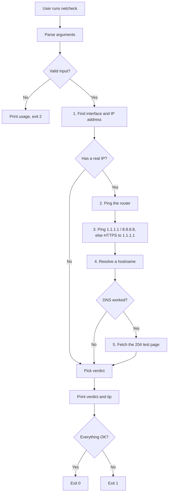

# netcheck

> `netcheck` — checks your connection one layer at a time (Wi-Fi, router, internet, DNS, web) and tells you in plain English which part is broken.

**Team:** [Rushikesh Hadawale], [Keshav sahu]
**Repository:** [https://github.com/Rushikesh-Hadawale/netcheck-Bash-Project]
**Date:** 28-10-2026

---

## 1. The problem

### What we keep doing by hand

When the internet stops working we run the same checks by hand, one after another, to work out whether the problem is the Wi-Fi, the router, DNS, or the internet itself:

```bash
ip a                      # do we even have an IP address?
ping -c 3 192.168.1.1     # can we reach the router?
ping -c 3 1.1.1.1         # can we reach the internet by IP?
cat /etc/resolv.conf      # which DNS server are we using?
ping -c 3 example.com     # does a name resolve?
curl -I https://example.com   # does a web request work?
```

Reading the output of each command and combining the results in our head is the slow part, especially on unreliable college Wi-Fi where we do this several times a week.

### Evidence that this is real

```bash
history | grep -E "ping|resolv.conf|ip a|curl" | wc -l
```

```
# TODO: paste the real output from your own laptop here
```

> TODO: two sentences — how often does this happen, and what does it cost you each time?

### Who else has this problem

> TODO: one or two sentences — who you asked in your class, and what they said.

---

## 2. Prior art — what already exists

### Tools we found and actually tried

| Tool | Where we found it | What it does | Why it does not solve our problem |
|---|---|---|---|
| `mtr` | | Combines `ping` and `traceroute` and shows latency and packet loss for every hop to a destination | Shows numbers per hop but does not interpret them; it assumes DNS and the local interface already work, and does not say "your DNS is the problem" |
| `nmcli` | | Command-line client for NetworkManager; shows connection state and an overall connectivity status | Reports an overall state, but does not test the router, internet and DNS separately; Linux with NetworkManager only |
| macOS Wireless Diagnostics | | Built-in graphical tool that analyses Wi-Fi problems | Graphical, macOS only, Wi-Fi focused, and cannot be used in scripts |

### Evidence of trying them

```bash
# TODO: the command you ran
```

```
# TODO: what it printed
```

> TODO: one paragraph — what did the tool get right, and what exactly was missing?

### Where we searched

- [ ] `man -k <keyword>`
- [ ] GitHub search
- [ ] Homebrew: `brew search <keyword>`
- [ ] Stack Overflow
- [ ] npm / PyPI
- [ ] Asked a human: [who, and what they said]

### The gap, in one sentence

"Existing tools can measure individual parts of a connection, but none of them checks each layer in order and prints a plain-English verdict like 'Router reachable, DNS failing', which is the part that actually costs us time."

---

## 3. What we are building

### In scope

- Check five layers in order: network interface, router, internet (by IP address), DNS, and web.
- Print one line per layer with OK / FAIL / SKIP, then a plain-English verdict and a tip for fixing it.
- Recognise common real-world cases: no Wi-Fi, no address from the router, router unreachable, no internet past the router, DNS failing, and a captive portal (college or café Wi-Fi login page).
- Work when `ping` is blocked, by falling back to a web connection to `1.1.1.1`.
- Return exit codes so the tool can be used inside other scripts.

### Out of scope

- **Fixing the problem.** `netcheck` only diagnoses and never changes settings, restarts services or edits `/etc/resolv.conf`. A diagnosis tool that changes your system is harder to trust, and it keeps the tool safe to run anywhere.
- **Speed tests and long-term monitoring.** Tools such as `mtr` and `speedtest-cli` already do this, and it is a different problem from "why is it broken right now".
- **Windows.** Only Linux and macOS are supported.
- **IPv6.** Only IPv4 is checked, to keep the checks simple and the output readable.

### How we will know it worked

"This tool is successful if it turns 6 commands into 1, and we actually use it after the assignment ends."

---

## 4. Tech stack

| Choice | What we picked | Why, and what we rejected |
|---|---|---|
| Language | Bash | The whole job is running `ping`, `ip` and `curl` and reading their output, which is what shell is for. Rejected Python: it would be longer for no benefit, and it needs to be installed. |
| Argument parsing | A hand-written `case` loop | Built-in `getopts` does not support long options such as `--timeout`. Rejected external parsers to keep the tool dependency-free. |
| Other dependencies | None beyond `ping`, `ip` (or `route` on macOS), `curl`, and `getent` / `dig` / `host` | These already exist on almost every machine. Each missing tool makes that layer print SKIP instead of crashing. |
| Testing | A plain Bash test script using fake `ip`, `ping`, `curl`, `getent` and `dig` | Lets us reproduce every failure (no Wi-Fi, DNS down, captive portal...) on demand, which cannot be done reliably on a real network. Rejected `bats` to avoid an extra install. |
| Packaging / install method | A single executable file | Copy it into any folder on your `PATH`. Rejected a package manager release as too much for this scope. |

### Why this language

We both already know Bash and the commands we are wrapping are shell commands, so a shell script is the shortest path from what we do by hand today to a working tool. The honest trade-off is that Bash is awkward for text parsing, so we kept each check small and tested every verdict.

### What we are deliberately not using

We did not use Python or Go. A compiled or interpreted language would give nicer parsing but add an install step, and for a tool people run in a panic when the internet is down, "copy one file" is better.

---

## 5. Architecture



### Components

| Part | Responsibility | File |
|---|---|---|
| Argument parsing | Reads flags, validates timeout and hostname, prints help | `netcheck` (top of file) |
| Route and IP detection | Finds the default gateway, the interface and the IP address (`detect_route`, `detect_ip`) | `netcheck` |
| Network checks | `ping_host`, `resolve_system`, `public_dns_works`, and the web check | `netcheck` |
| Verdict logic | Combines the five layer results into one plain-English message and exit code | `netcheck` (bottom of file) |
| Tests | Fake network commands and one test per verdict | `tests/run_tests.sh` |

### Data flow

Input is the command-line flags and the system's own state. The tool gets the interface, IP and router address from `ip route` and `ip addr` (or `route` on macOS), measures the router and internet with `ping`, resolves a name with `getent` (or `dig` / `host`), and fetches a tiny test page with `curl`. Each layer's result is stored as `ok`, `fail` or `unknown`, and a short chain of `if` statements turns that combination into the final verdict.

### What happens when things go wrong

| If this happens | The tool does this |
|---|---|
| A needed command (`ip`, `ping`, `curl`, ...) is not installed | That layer prints SKIP with the reason; the other layers still run |
| The network blocks `ping` | Falls back to a web connection to `1.1.1.1` so it does not wrongly report "no internet" |
| DNS fails | Skips the web check (it would only fail for the same reason) and, if possible, tests whether public DNS `1.1.1.1` works to say whether the configured DNS server is the problem |
| The user passes a bad flag, a non-numeric timeout, or an invalid hostname | Prints a short error plus a hint to run `--help`, and exits with code 2 |
| A login page intercepts web traffic (captive portal) | Notices the test page did not return HTTP 204 and tells the user to sign in through a browser |

---

## 6. Usage

### Synopsis

```
netcheck [options]
```

### Commands and flags

| Flag | Long form | What it does | Default |
|---|---|---|---|
| `-h` | `--help` | Show usage and exit | |
| `-V` | `--version` | Show the version and exit | |
| `-v` | `--verbose` | Show extra detail (DNS server in use, web response code) | off |
| `-q` | `--quiet` | Print only the final verdict | off |
| `-t` | `--timeout SECS` | Seconds to wait for each check | 3 |
| `-H` | `--host NAME` | Hostname used for the DNS check | example.com |
| | `--no-color` | Turn off colored output (also off automatically when piped, or if `NO_COLOR` is set) | color on in a terminal |

> There is no `--dry-run` because `netcheck` is read-only: it never changes, moves or deletes anything, so every run is already safe to demo live.

### Examples

> The outputs below were produced by the test script's simulated network (`tests/run_tests.sh` creates fake `ip`, `ping`, `curl`, `getent` and `dig` commands) so that each failure can be shown on demand. **Re-run these on your own laptop before submitting and paste your real output.**

**Basic use (everything working)**

```bash
$ netcheck
```

```
netcheck 1.0.0
[1/5] Network interface  OK   wlan0 has 192.168.1.23
[2/5] Router             OK   192.168.1.1 answers (avg 5.0 ms, 0% loss)
[3/5] Internet           OK   1.1.1.1 answers (avg 5.0 ms, 0% loss)
[4/5] DNS                OK   example.com resolves
[5/5] Web                OK   web requests work

Verdict: All good: your connection, router, internet, DNS and web all work.
```

**With a flag (DNS failing, verbose)**

```bash
$ netcheck --verbose
```

```
netcheck 1.0.0
[1/5] Network interface  OK   wlan0 has 192.168.1.23
[2/5] Router             OK   192.168.1.1 answers (avg 5.0 ms, 0% loss)
[3/5] Internet           OK   1.1.1.1 answers (avg 5.0 ms, 0% loss)
[4/5] DNS                FAIL cannot look up example.com
      DNS server in use: 8.8.8.8
[5/5] Web                SKIP needs DNS to work first

Verdict: Internet reachable, DNS failing.
Tip:     Names cannot be looked up (server 8.8.8.8). A public server (1.1.1.1) works, so switch your DNS server to 1.1.1.1 or 8.8.8.8.
```

**Quiet mode (router down), useful in scripts**

```bash
$ netcheck --quiet; echo "exit code: $?"
```

```
Verdict: Cannot reach your router.
exit code: 1
```

**When it fails (wrong usage)**

```bash
$ netcheck --nonsense
```

```
netcheck: unknown option: --nonsense
Try 'netcheck --help' for usage.
```

### Exit codes

| Code | Meaning |
|---|---|
| 0 | Success: every layer works |
| 1 | A problem was found (the verdict says which) |
| 2 | Wrong usage: unknown flag, bad timeout or bad hostname |

### Installation

```bash
git clone <your repo>
cd <your repo>
chmod +x netcheck
mkdir -p ~/.local/bin
cp netcheck ~/.local/bin/        # make sure ~/.local/bin is in your PATH
netcheck --version
```

To run the tests:

```bash
./tests/run_tests.sh
```

Expected result: `19 passed, 0 failed`.

---

## 7. References

> TODO: add the links you actually used, with one line each.

- `man ping`, `man ip`, `man curl` — flags and output formats for the three commands `netcheck` wraps
- `man mtr` — how an existing tool reports per-hop latency and packet loss
- `man nmcli` — what NetworkManager's command-line client reports
- `http://connectivitycheck.gstatic.com/generate_204` — a public test page that answers with HTTP 204 and no content; any other response suggests a captive portal is intercepting traffic
