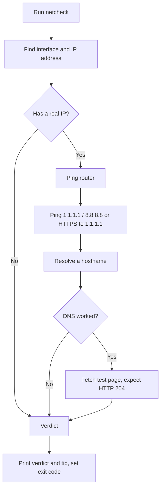

# netcheck

**Why is my internet not working?** `netcheck` checks your connection one layer at a time (network interface, router, internet, DNS, web) and tells you in plain English which part is broken.

```
$ netcheck
netcheck 1.0.0
[1/5] Network interface  OK   en0 has 192.168.1.23
[2/5] Router             OK   192.168.1.1 answers (avg 5.0 ms, 0% loss)
[3/5] Internet           OK   1.1.1.1 answers (avg 12.0 ms, 0% loss)
[4/5] DNS                FAIL cannot look up example.com
[5/5] Web                SKIP needs DNS to work first

Verdict: Internet reachable, DNS failing.
Tip:     Names cannot be looked up. Try another DNS server such as 1.1.1.1 or 8.8.8.8.
```

*(Example output. Your own addresses and timings will differ.)*

## The problem

When the internet stops working, we run `ip a`, `ping` the router, `ping 1.1.1.1`, `cat /etc/resolv.conf`, and `curl`, then work out the cause ourselves. This happens often on unreliable college Wi-Fi. `netcheck` runs all of these checks in order and gives one verdict.

## What it checks

| # | Layer | What it tests |
|---|---|---|
| 1 | Network interface | Do you have an IP address from the router? |
| 2 | Router | Does your router answer a ping? |
| 3 | Internet | Can you reach `1.1.1.1` / `8.8.8.8` by IP address? |
| 4 | DNS | Can a hostname be turned into an address? |
| 5 | Web | Does a tiny test page load? (Also detects captive-portal login pages.) |

Possible verdicts include: no network connection, router never gave an address, cannot reach the router, router reachable but no internet beyond it, internet reachable but DNS failing, captive portal blocking the internet, and web requests failing.

## Installation

Works on **macOS** and **Linux**. No extra software is needed.

```bash
git clone <your-repo-url>
cd <your-repo-folder>
bash netcheck
```

To use it from anywhere:

```bash
chmod +x netcheck
mkdir -p ~/.local/bin
cp netcheck ~/.local/bin/     # make sure ~/.local/bin is in your PATH
netcheck
```

## Usage

```
netcheck [options]
```

| Flag | Long form | What it does | Default |
|---|---|---|---|
| `-h` | `--help` | Show usage and exit | |
| `-V` | `--version` | Show the version and exit | |
| `-v` | `--verbose` | Show extra detail (DNS server in use, web response code) | off |
| `-q` | `--quiet` | Print only the final verdict | off |
| `-t` | `--timeout SECS` | Seconds to wait for each check | 3 |
| `-H` | `--host NAME` | Hostname used for the DNS check | example.com |
| | `--no-color` | Turn off colored output | color on in a terminal |

### Exit codes

| Code | Meaning |
|---|---|
| 0 | Everything works |
| 1 | A problem was found (the verdict says which) |
| 2 | Wrong usage: unknown flag, bad timeout or bad hostname |

This makes `netcheck` usable in scripts:

```bash
netcheck -q || echo "Something is wrong with the connection"
```

### Try a DNS failure safely

```bash
bash netcheck -H doesnotexist.invalid
```

The internet works but this name cannot be resolved, so you should see "Internet reachable, DNS failing".

## How it works



- If `ping` is blocked on your network, it falls back to a web connection to `1.1.1.1` instead of wrongly reporting "no internet".
- If a command it needs is not installed, that layer prints `SKIP` and the rest still run.
- The web check fetches `http://connectivitycheck.gstatic.com/generate_204`. It should answer with an empty HTTP 204; any other answer usually means a login page is intercepting traffic.

## Tests

The tests use fake `ip`, `ping`, `curl`, `getent` and `dig` commands, so every failure can be reproduced without touching your real network.

```bash
./tests/run_tests.sh
```

Expected on Linux: `19 passed, 0 failed`. On macOS the test script skips itself, because its fake commands imitate Linux.

## Limitations

- Diagnoses only. It never changes settings, restarts services or edits files.
- IPv4 only.
- Linux and macOS only (no Windows).
- Not a speed test or a long-term monitor. Tools like `mtr` are better for that.

## Project structure

```
netcheck          the tool (a single Bash script)
tests/
  run_tests.sh    test script with fake network commands
PROJECT.md        project write-up for the assignment
README.md         this file
```

## Team

[Name 1], [Name 2]
